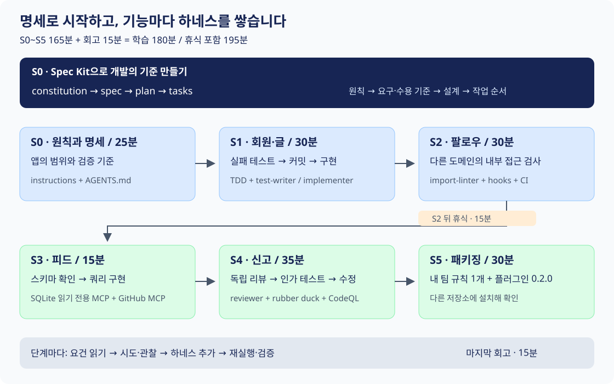
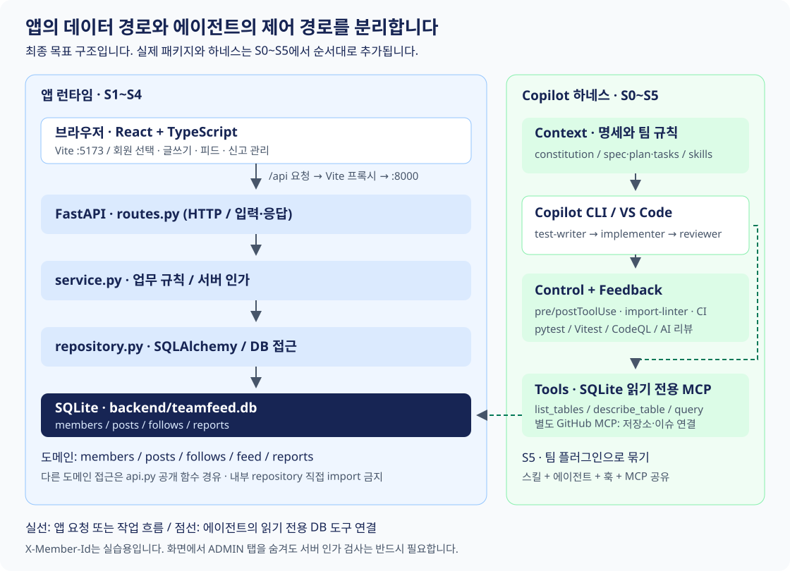
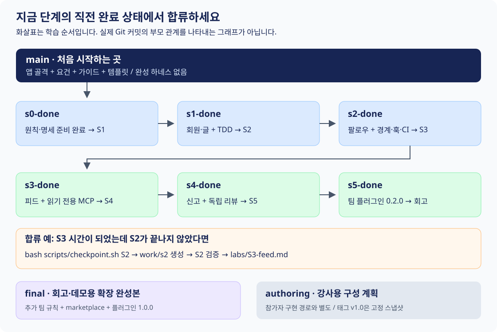

## TeamFeed Hands On Lab

GitHub Spec Kit으로 요구사항을 명세로 만들고, GitHub Copilot으로 사내 미니 SNS **TeamFeed**를 구현하는 실습입니다.
기능을 추가할 때마다 에이전트가 팀의 규칙을 지키도록 돕는 **하네스(harness)**를 한 겹씩 쌓습니다.
발표 자료의 Agenda 3, Hands On Lab에 해당합니다.

완성 앱을 복사하는 것이 아니라, “같은 요청을 규칙 없이 실행했을 때와 검증 장치를 붙인 뒤 실행했을 때 무엇이 달라지는가”를 관찰합니다.
앱 개발 경험이 있는 개발자를 대상으로 하며, Spec Kit이나 MCP를 처음 사용해도 단계별 가이드의 프롬프트로 진행할 수 있습니다.

> [!IMPORTANT]
> 처음 참여한다면 `main`에서 시작하세요. `s0-done`부터 `s5-done`까지는 단계별 정답이고, `final`은 완성본입니다.
> 이 README는 모든 브랜치에 공통으로 제공됩니다. 문서에 설명된 최종 기능이 현재 브랜치에 모두 구현되어 있다는 뜻은 아닙니다.

### 빠른 길찾기

| 지금 필요한 것 | 이동할 곳 |
|---|---|
| 처음 시작하기 | [시작하기](#시작하기) |
| 단계별 목표와 시간 확인 | [실습 지도](#실습-지도) |
| 명세에서 구현까지의 순서 | [Spec Kit과 Copilot의 역할](#spec-kit과-copilot의-역할) |
| 앱과 하네스의 구조 이해 | [아키텍처](#아키텍처) |
| 실행·테스트 명령 확인 | [실행과 검증](#실행과-검증) |
| 늦었거나 막혔을 때 합류 | [브랜치와 체크포인트](#브랜치와-체크포인트) |
| 오류를 해결하고 싶을 때 | [자주 막히는 지점](#자주-막히는-지점) |

## 무엇을 만들고 배우나요

TeamFeed는 회원을 선택하고 짧은 글을 작성한 뒤, 동료를 팔로우하여 글을 모아 보는 앱입니다.
부적절한 글을 신고하면 관리자가 승인하거나 반려하며, 승인된 글은 피드에서 숨겨집니다.

| 결과물 | 배우는 내용 |
|---|---|
| FastAPI + React 앱 | 회원·게시글 → 팔로우 → 피드 → 신고 기능의 점진적 구현 |
| 원칙과 명세 | constitution, spec, plan, tasks로 요구사항과 검증 기준 연결 |
| TDD와 역할 분리 | 실패 테스트 선작성·선커밋 후 구현, 테스트를 약하게 고치지 않기 |
| 훅과 CI | 위험한 도구 실행 차단, 패키지 경계 검사, 변경 후 테스트 피드백 |
| 읽기 전용 MCP | 스키마를 추측하지 않고 실제 DB에서 확인, 쓰기 권한 제한 |
| 독립 리뷰 | 작성자와 다른 맥락에서 관리자 인가 누락 발견 |
| 팀 플러그인 | 스킬·에이전트·훅·MCP를 다른 저장소에서도 재사용 |

실제 로그인, 비밀번호, 이미지 업로드, 댓글, 좋아요, 운영 배포는 범위 밖입니다.
요청 헤더 `X-Member-Id`로 회원을 지정하는 교육용 인증 방식을 사용합니다.
운영 서비스에서는 사용할 수 있는 인증 체계가 아니므로 실제 계정이나 민감 데이터를 넣지 마세요.
전체 범위는 [TeamFeed 비전과 MVP](requirements/00-vision.md)를 참고하세요.

## 시작하기

### 1. 계정과 환경 준비

* GitHub 계정과 Copilot Business 또는 Enterprise 라이선스
* 조직 정책에서 Copilot CLI, MCP 및 필요한 프리뷰 기능 사용 허용
* GitHub Codespaces 또는 VS Code + Dev Containers 사용 환경
* CodeQL은 공개 저장소 또는 GitHub Code Security 사용 권한 필요. 없으면 강사 데모로 대체

Codespaces를 권장합니다. 제공된 [개발 환경 설정](.devcontainer/devcontainer.json)은 Python 3.12, Node.js 22와 GitHub CLI를 준비합니다.
[초기화 스크립트](.devcontainer/post-create.sh)가 uv, Copilot CLI, Specify CLI 및 앱 의존성을 설치합니다.
첫 구성에는 네트워크와 설치 시간이 필요하므로 워크샵 전에 열어 두세요.
상세 점검은 [사전 준비 체크리스트](facilitator/prerequisites-checklist.md)를 따릅니다.

### 2. 내 실습 저장소 만들기

GitHub에서 **Use this template**을 선택하고 **Include all branches**를 체크하세요.
내 저장소에서 **Code → Codespaces → Create codespace on main**으로 환경을 엽니다.
로컬에서는 내 저장소를 clone한 뒤 VS Code의 **Dev Containers: Reopen in Container**를 실행합니다.

템플릿 대신 원본을 clone해서 시작할 수도 있습니다. 원본 저장소에 대한 push 권한은 필요하지 않습니다.
개인 커밋을 푸시하거나 이슈·PR을 만들려면 본인 소유 저장소를 사용하세요.

```bash
git clone https://github.com/daeungo1/msft-ghcp-dev-workshop.git
cd msft-ghcp-dev-workshop
git switch main
git switch -c work/my-workshop
```

> [!NOTE]
> 아래 셸 예시는 Codespaces, Dev Container 또는 WSL의 Bash 기준입니다.
> Windows PowerShell에서 `.sh` 파일을 직접 실행하지 마세요. 네이티브 Windows/Git Bash는 도구 경로와 인코딩 차이가 있으므로 컨테이너 환경을 우선 사용하세요.

### 3. 도구 확인과 로그인

저장소 루트에서 실행합니다.

```bash
git branch --show-current
copilot --version
uv --version
node -v
specify --help
```

`copilot`을 실행한 뒤 필요하면 `/login`으로 로그인합니다.
VS Code는 GitHub 계정으로 로그인하고 Copilot Chat을 엽니다.
CLI에서 폴더 신뢰를 확인하면 본인의 실습 저장소인지 확인한 뒤 허용하세요.

컨테이너 초기화가 끝나지 않았거나 로컬에서 직접 의존성을 준비하는 경우:

```bash
# 저장소 루트에서 실행. 최초 설치는 네트워크가 필요합니다.
uv sync --directory backend
npm --prefix frontend install

# Specify CLI가 없을 때만 설치합니다.
uv tool install specify-cli --from git+https://github.com/github/spec-kit.git
```

`main`은 앱과 하네스를 만들기 전의 출발점입니다. 다음 명령으로 시작 상태를 확인한 뒤 [S0 가이드](labs/S0-spec.md)로 이동하세요.

```bash
bash scripts/verify-step.sh --check-main
```

## 실습 지도



표의 시간은 S0~S5 실습 165분, 회고 15분으로 학습 시간 180분입니다.
S2 뒤 휴식 15분까지 포함하면 전체 진행 시간은 **195분**입니다.
세션을 180분 안에 마쳐야 한다면 선택 활동이나 휴식 시간을 강사와 조정하세요.

| 단계 | 시간 | 만드는 기능 / 산출물 | 더하는 하네스 | 시작 → 완료 | 상세 가이드 / 요건 |
|---|---|---|---|---|---|
| S0 | 25분 | 원칙, MVP 명세, 설계, 작업 목록 | constitution, instructions, AGENTS.md | `main` → `s0-done` | [S0](labs/S0-spec.md) / [비전](requirements/00-vision.md) |
| S1 | 30분 | 회원 가입, 글 작성·목록, 화면 뼈대 | TDD 스킬, test-writer, implementer | `s0-done` → `s1-done` | [S1](labs/S1-member-post.md) / [회원·게시글](requirements/01-member-post.md) |
| S2 | 30분 | 팔로우·언팔로우 | import-linter, pre/postToolUse 훅, CI | `s1-done` → `s2-done` | [S2](labs/S2-follow.md) / [팔로우](requirements/02-follow.md) |
| 휴식 | 15분 | 진행 상태 점검 | 해당 없음 | 현재 작업 유지 | 강사에게 막힌 점 공유 |
| S3 | 15분 | 팔로우한 사람과 내 글의 커서 기반 피드 | SQLite 읽기 전용 MCP, GitHub MCP | `s2-done` → `s3-done` | [S3](labs/S3-feed.md) / [피드](requirements/03-feed.md) |
| S4 | 35분 | 신고, 관리자 검색·승인·반려, 글 숨김 | 읽기 전용 리뷰어, rubber duck, CodeQL | `s3-done` → `s4-done` | [S4](labs/S4-report.md) / [신고](requirements/04-report.md) |
| S5 | 30분 | 팀 규칙 1개를 더한 플러그인 `0.2.0` | 플러그인 설치와 공유 | `s4-done` → `s5-done` | [S5](labs/S5-package.md) / [패키징](requirements/05-package.md) |
| 회고 | 15분 | 팀에서 도입할 규칙과 검증 장치 선정 | 자가진단 | 완성본 비교 | [회고](labs/99-retro.md) / [자가진단 카드](templates/self-check-card.md) |

### 매 단계의 진행 방식

S0~S4는 다음 순서로 진행합니다. S5는 기능 구현 대신 패키징과 설치를 확인합니다.

1. 해당 단계의 요건과 Given/When/Then 수용 기준을 읽습니다.
2. 이번 단계의 추가 하네스 없이 Copilot에 구현을 요청합니다. 앞 단계의 하네스는 유지합니다.
3. 구조 차이, 테스트 누락, 경계 위반, 스키마 추측, 인가 누락 중 무엇이 나타나는지 관찰합니다.
4. 가이드에 따라 변경을 보관하고 하네스를 추가합니다. S4는 기존 구현을 리뷰 대상으로 유지합니다.
5. 같은 요청을 다시 실행하여 차이를 비교하고, 테스트를 직접 실행합니다.
6. `bash scripts/verify-step.sh S<N>`의 결과를 확인하고 커밋합니다.

모델이 처음부터 규칙을 지켰다면 함정을 억지로 만들 필요는 없습니다.
관찰한 결과와 실행한 명령을 기록하세요. 프롬프트의 안내, 자동 검사, AI 리뷰는 서로 다른 수준의 보장을 제공합니다.

## Spec Kit과 Copilot의 역할

Spec Kit은 “무엇을 왜 만들고 어떤 기준으로 확인할지”를 파일로 남기는 흐름을 제공합니다.
Copilot은 그 명세와 팀 규칙을 읽고 테스트·구현·리뷰 작업을 수행합니다.
Spec Kit 명령은 채팅에서 실행하고, `specify`와 테스트 명령은 터미널에서 실행하세요.

### S0에서 명세 준비

초기화 전에 변경을 커밋하거나 stash로 보관하세요.
`--force`는 기존 파일과 겹칠 수 있으므로 실행 후 diff를 확인합니다.

```bash
specify init --here --force --integration copilot
git diff --stat
```

아래 명령 표기는 이 저장소의 가이드 기준입니다.
설치 버전에 따라 CLI 옵션이나 채팅 명령 이름이 다르면 `specify init --help`와 생성된 프롬프트 목록을 확인하세요.
구체적인 입력은 [S0 스타터 프롬프트](templates/starter/s0/README.md)를 참고합니다.

| 순서 | 채팅에서 실행 | 결과 | 확인할 내용 |
|---|---|---|---|
| 1 | `/speckit-constitution` | `.specify/memory/constitution.md` | 테스트 우선, 패키지 경계, 작은 변경, 에러 형식, 보안, DB 접근의 6개 원칙과 검증 방법 |
| 2 | `/speckit-specify` + 비전 내용 | `specs/<번호>-<이름>/spec.md` | MVP 범위와 수용 기준 |
| 3 | `/speckit-plan` + 기술 스택·패키지 구조 | 같은 폴더의 `plan.md` | 구현 구조와 도메인 간 공개 API |
| 4 | `/speckit-tasks` | 같은 폴더의 `tasks.md` | 테스트와 구현의 순서, 단계별 작업 범위 |

Spec Kit 초기화·명세 생성 과정에서 기능 브랜치가 생길 수 있습니다.
`git branch --show-current`로 현재 위치를 확인하세요. 예시 폴더명 `001-teamfeed-mvp`에 맞추기보다 실제 생성된 경로를 사용합니다.

### S1 이후 구현과 검증

S0에서 앱 전체를 한 번에 구현하지 마세요.
S1~S4는 현재 단계의 요건에 해당하는 작업만 선택하고, `test-writer`로 실패 테스트를 먼저 커밋한 뒤 `implementer`로 구현합니다.
`/speckit-implement`를 사용할 때도 현재 단계의 작업 범위와 테스트 우선 절차를 명시하세요.

```text
현재 단계는 S1이다. requirements/01-member-post.md와 생성된 spec, plan, tasks를 확인해줘.
현재 단계의 수용 기준만 실패하는 테스트로 옮기고 실행 결과를 보여줘.
테스트를 먼저 커밋한 뒤 구현해줘. S2 이후 기능은 구현하지 말고 테스트를 고쳐서 통과시키지 마.
```

S4의 수렴은 “독립 리뷰 → 실패하는 인가 테스트 → 구현 수정 → 재검증”입니다.
`/speckit-converge` 같은 추가 명령이 모든 Spec Kit 설치에 있다고 가정하지 않습니다.
이 저장소의 [S4 리뷰 절차](labs/S4-report.md)를 기준으로 진행하세요.

## 아키텍처



### 앱의 요청 흐름

React + TypeScript 화면은 Vite의 5173 포트에서 실행됩니다.
화면의 `/api` 요청은 Vite 프록시를 통해 FastAPI의 8000 포트로 전달됩니다.
도메인 내부에서는 HTTP 처리, 업무 규칙, DB 접근을 분리합니다.

```text
routes.py → service.py → repository.py → SQLite
다른 도메인의 기능이 필요하면 → 그 도메인의 api.py → 공개 함수
```

| 패키지 | 책임 | 도입 단계 |
|---|---|---|
| `members` | 회원 가입·조회와 회원 존재 확인 | S1 |
| `posts` | 글 작성·조회, 숨김 상태 | S1, S4 |
| `follows` | 팔로우 관계 관리 | S2 |
| `feed` | 본인과 팔로우 대상의 글 집계 | S3 |
| `reports` | 신고 등록 및 관리자 처리 | S4 |

각 도메인에는 `models.py`, `schemas.py`, `routes.py`, `service.py`, `repository.py`, `api.py`를 둡니다.
공용 DB·에러·인가 처리는 `db.py`, `errors.py`, `security.py`로 분리합니다.
실제 파일은 단계가 진행되면서 생깁니다.

다른 도메인의 `repository.py`를 직접 import하지 않는 것이 경계 규칙입니다.
S2의 import-linter 계약으로 현재 존재하는 패키지 간 접근을 검사하고, 도메인이 추가되면 계약도 갱신합니다.
오류 응답은 `{"error": {"code": "NOT_FOUND", "message": "..."}}` 형태로 통일합니다.

### 하네스는 앱과 별도의 제어 계층

| 계층 | 자산 | 효과와 한계 |
|---|---|---|
| Context | 원칙, 명세, instructions, AGENTS.md, 스킬 | 에이전트에게 팀 규칙을 안내하지만 준수를 보장하지 않음 |
| Tools | 커스텀 에이전트의 도구 제한, 읽기 전용 SQLite MCP | 필요한 사실만 제공하고 도구 권한의 범위를 제한 |
| Control Flow | test-writer → implementer, preToolUse, import 계약 | 순서와 실행 가능 범위를 통제. 설정·규칙 자체도 검증 필요 |
| Feedback | pytest, Vitest, postToolUse, CI, CodeQL, 독립 리뷰 | 자동 검사는 정의한 조건을 검증. AI 리뷰는 추가 판단을 제공하지만 누락 가능 |

SQLite MCP의 `list_tables`, `describe_table`, `query`는 에이전트가 스키마를 확인하는 통로입니다.
앱의 DB 쓰기는 repository가 수행하며, MCP에 쓰기 권한을 주지 않습니다.
VS Code 설정은 [VS Code MCP 템플릿](templates/mcp/vscode-mcp.json)의 `servers`,
Copilot CLI 설정은 [CLI MCP 템플릿](templates/mcp/copilot-cli-mcp.json)의 `mcpServers`를 사용합니다.

## 저장소 구조

```text
msft-ghcp-dev-workshop/
├── .devcontainer/        개발 환경과 최초 의존성 설치
├── backend/              FastAPI 앱, 도메인별 테스트, 의존성 설정
├── frontend/             React + TypeScript 화면, Vitest, Vite 프록시
├── requirements/         00 비전부터 05 패키징까지 요건과 수용 기준
├── labs/                 S0~S5 진행 가이드, 프롬프트, 관찰·완료 확인
├── templates/            스타터, 훅 fixture, MCP 서버, CI, 플러그인 골격
├── scripts/              단계 검증, 체크포인트 이동, 개발 서버, DB 시드
├── docs/                 개념, 워크샵 이후 안내, SVG 도식
├── bp-catalog/           업계 패턴과 우리 팀 BP(Best Practice) 매핑
└── facilitator/          강사용 준비·진행표·트러블슈팅
```

S0 이후 `.specify/`, `specs/`, `AGENTS.md`와 `.github/` 아래 하네스가 추가됩니다.
S3 이후 MCP 연결 설정, S5 이후 `plugins/teamfeed-harness/`가 추가됩니다.
`main`에 이러한 완성 자산이 없는 것은 정상입니다.

## 실행과 검증

아래 명령은 저장소 루트에서 실행합니다.
검증 스크립트는 항목별 성공·실패와 힌트를 출력하며, 실패가 있으면 종료 코드 1을 반환합니다.
오류 세부 내용이 숨겨져 있으면 해당 테스트를 직접 실행하세요.

| 목적 | 명령 | 실행 시점 |
|---|---|---|
| 출발점 검사 | `bash scripts/verify-step.sh --check-main` | S0 이전 |
| 현재 단계 검사 | `bash scripts/verify-step.sh S1` | `S1`을 현재 단계 번호로 바꿔 사용 |
| 전체 누적 검사 | `bash scripts/verify-step.sh ALL` | S5 완료 또는 `final` |
| 백엔드 테스트 | `uv run --directory backend pytest` | S1 이후 |
| 프론트엔드 테스트 | `npm --prefix frontend test` | 화면 구현 이후 |
| 프론트엔드 빌드 | `npm --prefix frontend run build` | 타입 검사·빌드 확인 |
| 패키지 경계 검사 | `uv run --directory backend lint-imports` | S2 계약 작성 이후 |
| 훅 fixture 검사 | `bash scripts/hooks/test_hooks.sh` | S2에서 훅 파일 복사·구현 이후 |
| 앱 실행 | `bash scripts/dev.sh` | S1 구현 이후 |
| S3 DB 시드 | `uv run --directory backend python ../scripts/seed-db.py` | S3 데이터 준비 |

> [!WARNING]
> 시드 스크립트는 기존 회원·글·팔로우·신고 데이터를 지우고 실습 데이터로 다시 채웁니다.
> 실습 DB에만 실행하세요. 회원 20명, 글 200개, 팔로우 60개를 생성하며 `member01`은 ADMIN입니다.
> 서버와 MCP가 같은 `backend/teamfeed.db`를 사용하도록 작업 디렉터리와 `TEAMFEED_DB` 경로를 확인하세요.

앱 실행 후 [화면](http://localhost:5173)과 [FastAPI 문서](http://localhost:8000/docs)를 엽니다.
Codespaces에서는 **Ports** 탭의 전달된 주소를 사용하세요.
회원 가입·글쓰기는 S1부터, 피드는 S3부터, 신고 관리 화면은 S4부터 확인할 수 있습니다.
개발 서버는 실행한 터미널에서 `Ctrl+C`로 종료합니다.

단계 검증은 파일 존재나 특정 패턴을 확인하는 항목도 포함합니다.
검증 스크립트가 통과했다는 사실만으로 UI 동작, 모든 인가 경로, 실제 훅 실행 또는 플러그인 이식성을 보장하지 않습니다.
각 가이드의 수동 확인까지 수행하고 실행한 명령과 결과를 남기세요.

## 브랜치와 체크포인트



| 브랜치 | 포함 상태 | 참여자 사용법 |
|---|---|---|
| `main` | 앱 골격, 요건, 가이드, 템플릿 | 처음 시작하는 기준점 |
| `s0-done` | 원칙과 spec/plan/tasks | S1 시작 전 합류 |
| `s1-done` | 회원·게시글, TDD 스킬과 두 역할 | S2 시작 전 합류 |
| `s2-done` | 팔로우, import 계약, 훅, CI | S3 시작 전 합류 |
| `s3-done` | 피드와 MCP 설정 | S4 시작 전 합류 |
| `s4-done` | 신고·관리자 처리, 독립 리뷰와 CodeQL | S5 시작 전 합류 |
| `s5-done` | 팀 플러그인 `0.2.0` | 패키징 결과 비교 |
| `final` | 완성 앱, 추가 팀 규칙과 marketplace, 플러그인 `1.0.0` | 회고·강사 데모 기준 |
| `authoring` | 저장소 구성 계획 | 강사용. 참가자 실습에는 불필요 |

이 표는 브랜치 이름의 실습 목적을 설명합니다. 실제 구현의 통과 여부는 해당 브랜치에서 검증하세요.
태그 `v1.0`은 특정 시점의 스냅샷이므로 이후 문서 갱신이 있는 `final` 브랜치와 다를 수 있습니다.

### 진행이 늦어졌다면

S3를 시작해야 하는데 S2가 끝나지 않았다면 **S2 완료 상태**를 가져옵니다.
자신의 구현이 정상적으로 진행 중이면 체크포인트를 실행할 필요가 없습니다.

```bash
bash scripts/checkpoint.sh S2
git branch --show-current
bash scripts/verify-step.sh S2
# 이제 labs/S3-feed.md부터 진행합니다.
```

[체크포인트 스크립트](scripts/checkpoint.sh)는 `s2-done`에서 `work/s2` 브랜치를 만듭니다.
로컬 변경과 추적되지 않은 파일은 stash에 보관하지만 자동으로 복원하지 않습니다.
동일 이름의 `work/s2` 브랜치가 이미 있으면 그 브랜치 포인터를 다시 설정하므로, 먼저 필요한 커밋을 다른 브랜치로 보관하세요.
`origin`에 정답 브랜치가 없으면 원본 저장소를 `upstream`으로 추가하고 가져옵니다.

```bash
git stash list
git stash show --stat 'stash@{0}'
# 보관한 변경이 무엇인지 확인한 뒤에만 apply/pop 여부를 결정합니다.

git fetch origin
git diff origin/s1-done..origin/s2-done --stat
git show origin/s2-done:.github/hooks/guardrails.json
```

## 자주 막히는 지점

| 증상 | 확인과 대응 |
|---|---|
| `/speckit-*` 명령이 보이지 않음 | S0 초기화 결과와 생성된 프롬프트를 확인하고 채팅을 새로 시작. 버전별 명령·옵션은 `specify init --help` 확인 |
| `main`에서 개발 서버가 실행되지 않음 | 정상적인 출발 상태일 수 있음. S1 구현을 마치거나 `s1-done` 체크포인트에서 합류 |
| 단계 검사가 멈추거나 실패만 표시 | 표의 백엔드·프론트엔드 테스트를 직접 실행해 오류 확인. 테스트 파일 0개인 성공도 기능 검증으로 간주하지 않기 |
| Windows Python Store 창, 경로·인코딩 오류 | Codespaces/WSL/Dev Container로 전환. Git Bash에서는 실제 실행 가능한 Python과 uv가 PATH에 있는지 확인 |
| 의존성 설치·TLS 오류 | 네트워크·사내 인증서를 먼저 확인하고 `uv sync` 실행. `--no-sync`는 설치가 끝난 환경에서만 사용하며 최초 설치를 대체하지 않음 |
| 훅이 거부하지 않음 | CLI를 저장소 루트에서 시작, 폴더 신뢰·JSON·실행 권한·fixture 검사 확인. 실제 세션의 차단을 별도로 관찰 |
| SQLite MCP 연결 실패 | 시드 생성 여부, 서버 시작 위치, `TEAMFEED_DB` 확인. VS Code는 `.vscode/mcp.json`, CLI는 `.mcp.json`의 서로 다른 설정 구조 확인 |
| 관리자 화면이 보이지 않음 | S4 구현 상태 및 선택 회원의 ADMIN 역할 확인. 화면을 숨기는 것과 서버 인가는 별개이며 일반 회원의 GET/PATCH 403도 테스트 |
| 플러그인 설치 경고 또는 훅 무반응 | [S5 가이드](labs/S5-package.md)에서 설치 방식 확인. 목록 등록만으로 훅 실행을 성공했다고 판단하지 않기 |
| GitHub MCP·CodeQL·PR 권한 없음 | 본인 저장소와 조직 정책 확인. 선택 활동은 강사 데모로 대체하고 로컬 테스트·리뷰는 계속 진행 |

훅은 구성된 도구 호출과 작성한 규칙의 범위에서 동작합니다. 모든 실행 경로를 막는 보안 샌드박스가 아닙니다.
스크립트 예외 시 차단되는지와 정상 작업은 허용되는지를 함께 확인하세요.
더 자세한 대응은 [트러블슈팅](facilitator/troubleshooting.md)을 참고합니다.
Windows 환경의 이전 실검증·개선 기록은 [`s1-done`의 report.md](https://github.com/daeungo1/msft-ghcp-dev-workshop/blob/s1-done/report.md)에 있으며, 다른 브랜치의 검증 결과로 일반화하지 않습니다.

## 워크샵 이후

1. [회고 가이드](labs/99-retro.md)와 [자가진단 카드](templates/self-check-card.md)에 팀에서 반복되는 문제를 적습니다.
2. [BP 카탈로그](bp-catalog/README.md)에서 해당 문제를 안내로 해결할지 자동 검사로 막을지 고릅니다.
3. [팀 규칙 템플릿](templates/team-rule-template.md)으로 규칙 하나를 만들고 검증 방법을 연결합니다.
4. [플러그인 템플릿](templates/plugin/README.md)과 [워크샵 이후 안내](docs/after-workshop.md)를 따라 실제 팀 저장소에 맞게 적용합니다.

강사는 [진행표](facilitator/run-of-show.md)와 [함정 관찰 기록](facilitator/trap-log.md)을 참고하세요.
발표 자료의 `start`는 이 저장소의 `main`에 해당합니다.

### 공식 참고 자료

* [GitHub Spec Kit](https://github.com/github/spec-kit)
* [Copilot customization cheat sheet](https://docs.github.com/en/copilot/reference/customization-cheat-sheet)
* [Copilot hooks](https://docs.github.com/en/copilot/concepts/agents/hooks)
* [Copilot plugins](https://docs.github.com/en/copilot/concepts/agents/about-plugins)
* [Copilot CLI rubber duck](https://docs.github.com/en/copilot/concepts/agents/copilot-cli/rubber-duck)
* [GitHub awesome-copilot](https://github.com/github/awesome-copilot)
* [Microsoft HVE Core](https://github.com/microsoft/hve-core)

라이선스는 [MIT](LICENSE)입니다.
