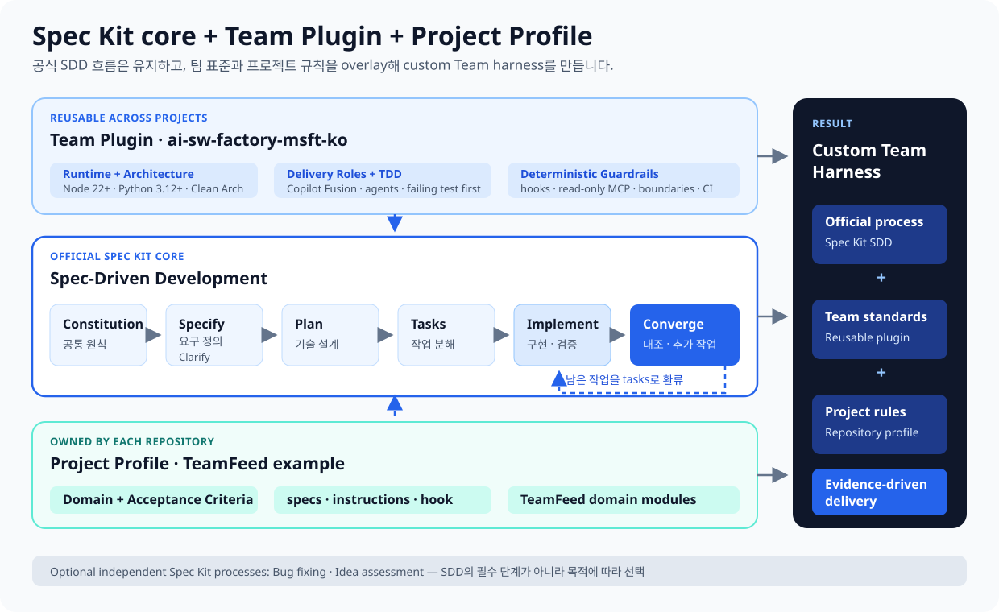
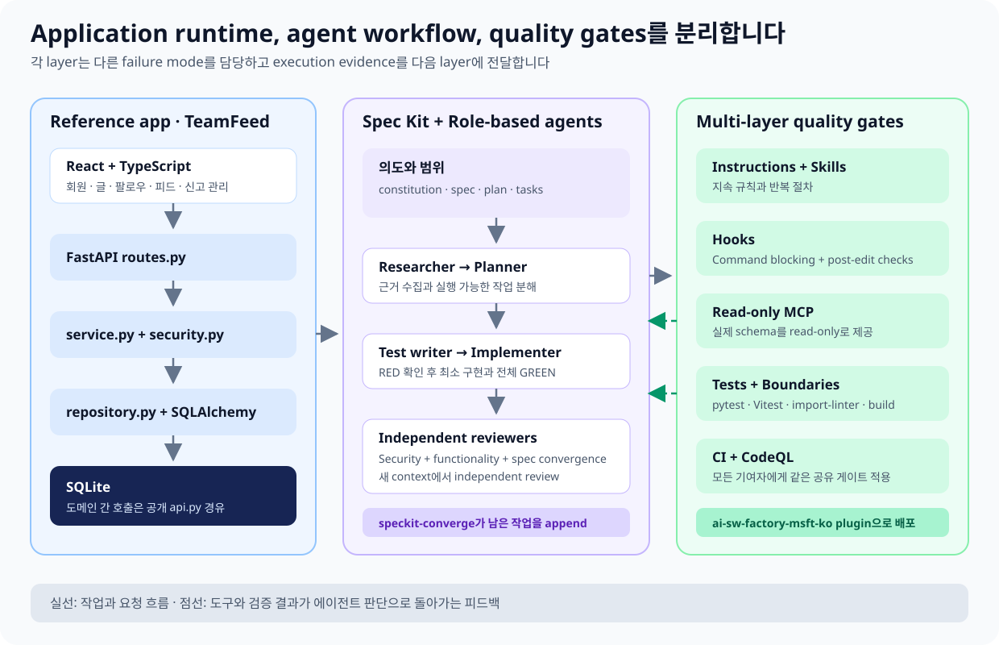
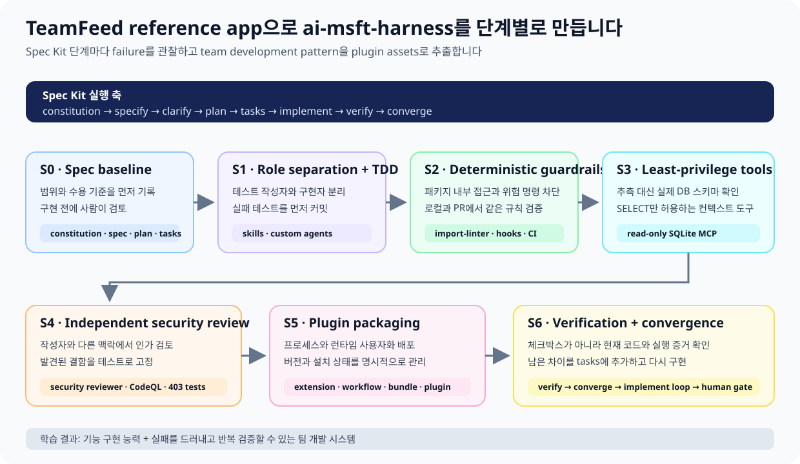
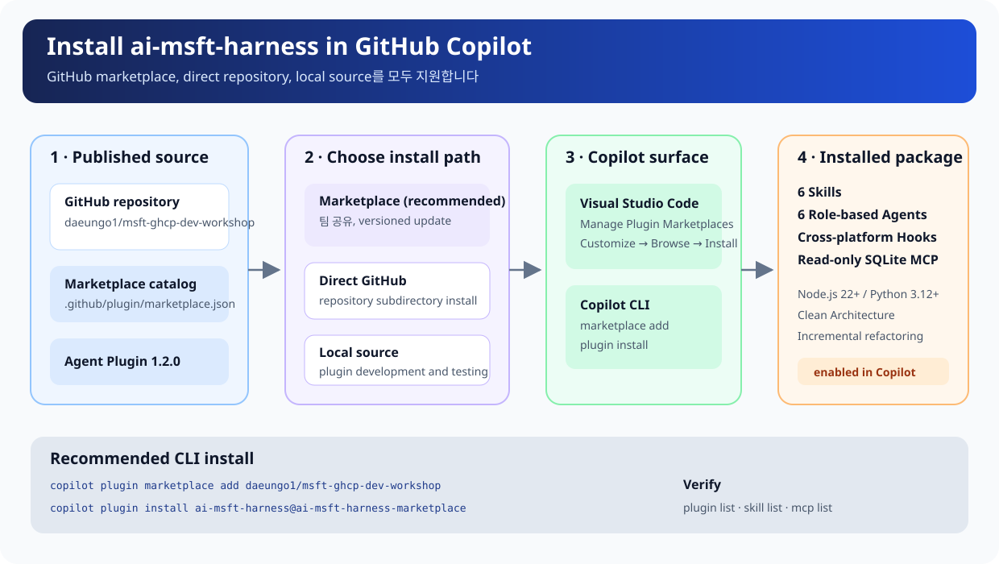
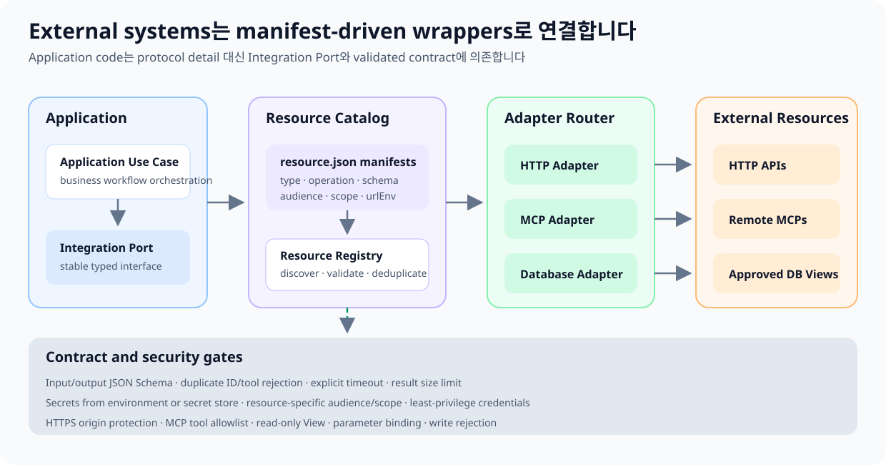
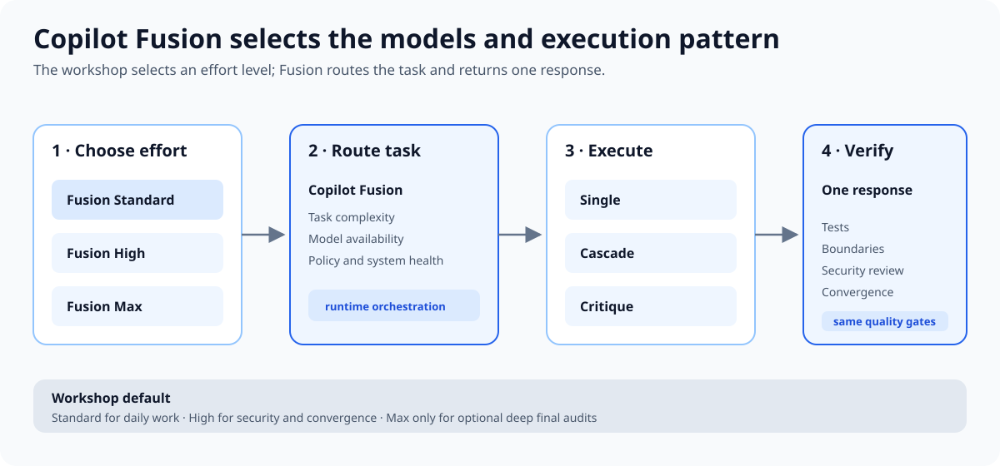
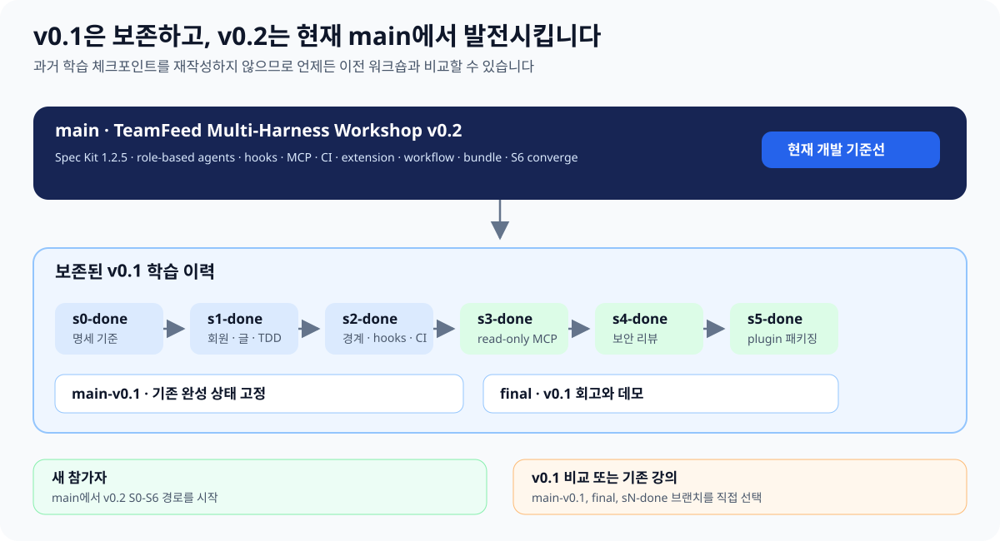

# AI SW Factory MSFT KO

[](https://github.com/daeungo1/msft-ghcp-dev-workshop/actions/workflows/validate-marketplace.yml)

`ai-sw-factory-msft-ko`는 **Spec Kit 기반의 custom Team harness**입니다.
Spec Kit이 제공하는 specification-driven delivery를 공통 개발 흐름으로
사용하고, 우리 팀의 runtime, architecture, TDD, security, verification
기준을 GitHub Copilot customization으로 추가합니다.

즉, Spec Kit을 대체하거나 fork하는 framework가 아닙니다. Spec Kit core
위에 team-specific instructions, skills, agents, hooks, MCP, CI를
overlay하고, 그 결과를 **설치 가능한 GitHub Copilot Agent Plugin**으로
배포합니다.

TeamFeed는 최종 제품이 아니라 harness를 만들고 검증하기 위한 reference
application입니다. 회원, 게시글, 팔로우, 피드, 신고 기능을 구현하며
instructions, skills, agents, hooks, MCP, CI가 각각 어떤 failure를 막는지
확인합니다.

> [!IMPORTANT]
> **최종 산출물:** [`ai-sw-factory-msft-ko` 2.0.0](plugins/ai-sw-factory-msft-ko/)
>
> Node.js 22+, Python 3.12+, Clean Architecture, role-based agents, TDD,
> cross-platform hooks, read-only MCP, convergence workflow를 하나의
> Agent Plugins 1.0 package로 제공합니다.



위 workflow에서 **Spec Kit core는 개발 절차**, **Team Plugin은 여러
프로젝트가 공유하는 개발 표준**, **Project Profile은 현재 repository의
domain과 acceptance criteria**를 담당합니다. 세 layer를 분리해 Spec Kit
update, team policy release, project change를 서로 독립적으로 관리합니다.

## Summary — 무엇을 만드는가?

| 항목 | 내용 |
|---|---|
| Goal | Spec Kit 위에 팀의 개발 방식과 quality gates를 추가한 custom Team harness |
| Method | Spec Kit → role separation → TDD → guardrails → verification → convergence |
| Reference app | FastAPI + React 기반 TeamFeed |
| Deliverable | VS Code와 Copilot CLI에 설치하는 `ai-sw-factory-msft-ko` plugin |
| Runtime baseline | Node.js 22+, Python 3.12+ |
| Architecture | Module-first Clean Architecture, ports and adapters, incremental refactoring |
| Distribution | GitHub-hosted marketplace, direct GitHub, local source |

### 바로 이동

| 하고 싶은 일 | 이동 |
|---|---|
| Plugin을 바로 설치 | [Quick install](#quick-install) |
| 무엇이 포함되는지 확인 | [What you get](#what-you-get) |
| 구조와 책임 경계 이해 | [Architecture](#architecture) |
| 워크숍을 처음부터 진행 | [Workshop guide](#workshop-guide) |
| 다른 설치 방식 확인 | [Installation details](#installation-details) |
| 검증 명령 실행 | [Validation](#validation) |
| Plugin update 또는 publish | [Plugin operations](#plugin-operations) |

## Quick install

다른 사용자와 팀에 배포할 때는 marketplace install을 권장합니다.
아래 명령은 VS Code의 **Terminal → New Terminal**에서 한 줄씩 실행합니다.
Chat 입력창이나 **Install Plugin from Source** 창에 입력하지 않습니다.

```powershell
copilot --version
copilot plugin marketplace add daeungo1/msft-ghcp-dev-workshop
copilot plugin marketplace browse ai-sw-factory-msft-ko-marketplace
copilot plugin install ai-sw-factory-msft-ko@ai-sw-factory-msft-ko-marketplace
```

`Marketplace ... already registered`가 표시되면 이미 등록된 상태입니다.
다음 `browse`와 `install` 명령을 계속 실행하면 됩니다.

설치 결과를 확인합니다.

```powershell
copilot plugin marketplace list
copilot plugin list
copilot skill list
copilot mcp list
```

정상 상태:

* Plugin: `ai-sw-factory-msft-ko` version `2.0.0`, enabled
* Skills: 6
* Agents: 6
* Hooks: cross-platform `PreToolUse` / `PostToolUse`
* MCP: optional `sqlite-ro`

VS Code에서는 **Chat: Manage Plugin Marketplaces**에서
`daeungo1/msft-ghcp-dev-workshop`를 추가한 뒤
**Customize → Browse**에서 `ai-sw-factory-msft-ko`를 설치합니다.
설치 후 보이지 않으면 **Developer: Reload Window**를 실행합니다.
전체 설치 방식은 [Installation details](#installation-details)를 참고하세요.

## What you get

| Package content | Responsibility |
|---|---|
| Instructions | Repository-wide rules와 path-specific constraints |
| Skills | Spec-driven delivery, team standards, evidence research, TDD, convergence, PR description |
| Role-based agents | Researcher, planner, test writer, implementer, security reviewer, convergence reviewer |
| Hooks | 위험 명령 차단과 post-edit verification |
| Read-only MCP | 실제 SQLite schema와 data를 least privilege로 조회 |
| CI contracts | Runtime, tests, boundaries, package structure를 공유 gate로 검증 |

Team application standards에는 다음 기준이 포함됩니다.

* Node.js hard floor `>=22`; production은 Active LTS 또는 Maintenance LTS
* Python hard floor `>=3.12`; 새 서비스는 승인된 최신 bugfix release 우선
* `Adapters → Application Use Cases → Core` dependency direction
* Module 또는 service 단위의 incremental refactoring
* Legacy modernization은 characterization test와 Strangler Fig 우선
* SQL parameter binding, server-side authorization, explicit error handling

## Architecture

Harness는 하나의 거대한 prompt가 아닙니다. 변경 속도와 책임이 다른 세
layer를 조합합니다.

Spec Kit core는 모든 팀이 공유하는 delivery flow를 담당합니다. Team
plugin은 여러 repository에서 재사용할 개발 표준과 automation을 담당하고,
Project profile은 각 application의 domain과 acceptance criteria를
담당합니다. 이 분리 덕분에 Spec Kit update, team policy release, project
변경을 서로 독립적으로 관리할 수 있습니다.

| Layer | Owner | Responsibility |
|---|---|---|
| Spec Kit core | `github/spec-kit` | constitution, specify, clarify, plan, tasks, implement, converge |
| Team plugin | `ai-sw-factory-msft-ko` | runtime/architecture standards, agents, TDD, hooks, MCP |
| Project profile | target repository | project constitution, specs, instructions, project hook |



핵심 원칙:

1. Spec Kit artifacts가 intent, scope, acceptance criteria를 고정합니다.
2. Research, test, implementation, review를 독립된 역할로 분리합니다.
3. Hooks, tests, boundaries, CI가 deterministic checks를 실행합니다.
4. `speckit-converge`가 specification과 code의 남은 차이를 tasks로 돌려보냅니다.
5. 검증된 team pattern만 plugin으로 package합니다.

더 자세한 책임 경계는
[Multi-Harness Architecture](docs/multi-harness-architecture.md)를 참고하세요.

---

## Workshop guide

S0–S6에서 TeamFeed 기능을 단계적으로 구현하면서
`ai-sw-factory-msft-ko`를 완성합니다. 앱 기능은 학습 시나리오이고,
각 단계에서 추가되는 harness layer가 핵심 결과물입니다.



### 1. 준비

권장 환경:

* GitHub Codespaces 또는 VS Code Dev Containers
* Python 3.12
* Node.js 22
* `uv`
* GitHub Copilot CLI 또는 VS Code Copilot Chat
* Spec Kit 1.2.5

#### Copilot Fusion 선택

워크숍의 기본 runtime model은 **Copilot Fusion Standard**입니다. Copilot
Fusion은 Project HydraFusion의 multi-model orchestration과 Copilot auto
model selection을 결합한 GitHub의 공식 GA 기능입니다.

VS Code의 model picker에서 **Copilot Fusion → Standard**를 선택합니다.
Copilot CLI interactive session에서는 `/model`을 입력하고 같은 항목을
선택합니다. Non-interactive 실행은 다음과 같습니다.

```bash
copilot --model fusion --fusion-tier standard -p "YOUR PROMPT"
```

| Workshop stage | 권장 effort | 기준 |
|---|---|---|
| S0–S3, S5 | Fusion Standard | 일상적인 조사, 계획, 구현, packaging |
| S4, S6 | Fusion High | Security review, cross-file reasoning, convergence |
| Final audit (optional) | Fusion Max | 가장 깊은 분석이 필요하고 추가 cost/latency를 허용할 때 |

Fusion이 model picker에 없으면 plan 또는 organization model policy를
확인합니다. 사용할 수 없는 tier를 조용히 대체하지 말고, 지원되는 model을
명시적으로 선택한 뒤 같은 tests와 quality gates를 실행합니다.

Repository와 dependencies를 준비합니다.

```bash
git clone https://github.com/daeungo1/msft-ghcp-dev-workshop.git
cd msft-ghcp-dev-workshop
git switch main

uv tool install specify-cli --force \
  --from git+https://github.com/github/spec-kit.git@v1.2.5
uv sync --directory backend
npm --prefix frontend install
```

준비 상태를 확인합니다.

```bash
specify --version
specify integration status --json
python scripts/validate-harness.py
```

Windows에서는 Bash hooks와 toolchain 차이를 줄이기 위해 Dev Container를
권장합니다.

### 2. 각 단계를 진행하는 방법

모든 lab은 같은 learning loop를 사용합니다.

```text
요건 읽기 → baseline 시도 → failure 관찰 → harness 추가
          → 다시 실행 → verification evidence 기록
```

1. 해당 lab 문서에서 요구사항과 acceptance criteria를 읽습니다.
2. 새 harness layer 없이 먼저 시도해 failure mode를 확인합니다.
3. 단계에서 요구하는 instruction, skill, agent, hook, MCP를 추가합니다.
4. targeted test를 먼저 실행하고 repository gate를 실행합니다.
5. 모델의 완료 선언이 아니라 command output을 evidence로 남깁니다.

### 3. S0–S6 learning path

| Stage | TeamFeed scenario | Harness focus | 완료 확인 |
|---|---|---|---|
| [S0 · Specification](labs/S0-spec.md) | 범위와 수용 기준 | constitution, spec, plan, tasks | `bash scripts/verify-step.sh S0` |
| [S1 · TDD](labs/S1-member-post.md) | 회원과 게시글 | role separation, failing test first | `bash scripts/verify-step.sh S1` |
| [S2 · Guardrails](labs/S2-follow.md) | 팔로우 | import boundaries, hooks, CI | `bash scripts/verify-step.sh S2` |
| [S3 · Context](labs/S3-feed.md) | 피드 | read-only SQLite MCP | `bash scripts/verify-step.sh S3` |
| [S4 · Security](labs/S4-report.md) | 신고와 관리자 처리 | independent security review, CodeQL | `bash scripts/verify-step.sh S4` |
| [S5 · Packaging](labs/S5-package.md) | 팀 배포 | Agent Plugin, marketplace, versioning | `bash scripts/verify-step.sh S5` |
| [S6 · Convergence](labs/S6-converge.md) | 완성도 확인 | verify, converge, human gate | `bash scripts/verify-step.sh S6` |

#### S0 — Specification baseline

구현 전에 constitution, feature spec, plan, tasks를 만듭니다. 요구사항,
acceptance criteria, non-goals가 코드보다 먼저 review 가능한 상태여야 합니다.

#### S1 — Role separation and TDD

Researcher와 planner가 근거와 작업을 정리하고, test writer가 실패 테스트를
먼저 만듭니다. Implementer는 테스트 기대값을 바꾸지 않고 최소 구현으로
GREEN을 만듭니다.

#### S2 — Deterministic guardrails

Instructions만으로 막기 어려운 package boundary 위반과 위험 명령을
import-linter, hooks, CI로 차단합니다. 같은 규칙이 local과 pull request에서
동작해야 합니다.

#### S3 — Least-privilege context

Schema를 추측하지 않고 read-only SQLite MCP로 확인합니다. Database write는
application repository layer만 담당하고 remote context tool은 SELECT만
허용합니다.

#### S4 — Independent security review

구현자와 다른 context에서 authorization, input validation, SQL, secret
exposure를 검토합니다. 발견된 결함은 재현 가능한 test로 고정합니다.

#### S5 — Plugin packaging

Agents, skills, hooks, MCP를 Agent Plugins 1.0 package로 묶습니다.
Marketplace catalog와 plugin version을 맞추고 Windows, macOS, Linux에서
동일한 validation을 실행합니다.

#### S6 — Verification and convergence

Spec, plan, tasks와 현재 code를 다시 비교합니다. 남은 차이는 tasks에
추가하고 implement → verify → converge loop를 반복한 뒤 human gate에서
종료합니다.

### 4. 워크숍 완료 확인

전체 단계 gate를 실행합니다.

```bash
bash scripts/verify-step.sh ALL
```

Reference application을 실행합니다.

```bash
bash scripts/dev.sh
```

* Frontend: `http://localhost:5173`
* Backend API: `http://localhost:8000`

마지막으로 local plugin을 설치해 다른 project에서도 discovery되는지
확인합니다.

```bash
copilot plugin marketplace add .
copilot plugin install ai-sw-factory-msft-ko@ai-sw-factory-msft-ko-marketplace
copilot plugin list
copilot skill list
copilot mcp list
```

> [!NOTE]
> TeamFeed의 `X-Member-Id`는 교육용 인증 방식입니다. 실제 account나
> sensitive data를 사용하지 마세요.

---

## Details and reference

### Installation details



#### Prerequisites

* GitHub에 로그인된 VS Code와 GitHub Copilot
* CLI 설치 시 `copilot --version`이 동작하는 환경
* Private repository 설치 시 repository read access
* Optional SQLite MCP 사용 시 `uv`와 Python 3.12+

> [!WARNING]
> Plugin은 agents, skills, hooks, MCP server를 설치합니다. 설치 전에
> [`plugin.json`](plugins/ai-sw-factory-msft-ko/plugin.json),
> [hooks](plugins/ai-sw-factory-msft-ko/com.github.copilot/hooks/hooks.json),
> [MCP configuration](plugins/ai-sw-factory-msft-ko/mcp.json)을 검토하세요.

#### Marketplace install — recommended

VS Code terminal에서 실행합니다.

```powershell
copilot plugin marketplace add daeungo1/msft-ghcp-dev-workshop
copilot plugin marketplace browse ai-sw-factory-msft-ko-marketplace
copilot plugin install ai-sw-factory-msft-ko@ai-sw-factory-msft-ko-marketplace
```

Marketplace가 이미 등록됐다는 메시지는 오류가 아닙니다. 다시 설치하거나
최신 version을 받을 때는 다음 명령을 사용합니다.

```powershell
copilot plugin marketplace update ai-sw-factory-msft-ko-marketplace
copilot plugin update ai-sw-factory-msft-ko@ai-sw-factory-msft-ko-marketplace
```

#### Direct GitHub install

Copilot CLI만 지원하는 repository subdirectory 설치 방식입니다.

```powershell
copilot plugin install `
  daeungo1/msft-ghcp-dev-workshop:plugins/ai-sw-factory-msft-ko
```

#### Local development install

```powershell
git clone https://github.com/daeungo1/msft-ghcp-dev-workshop.git
cd msft-ghcp-dev-workshop
copilot plugin marketplace add .
copilot plugin install ai-sw-factory-msft-ko@ai-sw-factory-msft-ko-marketplace
```

Local marketplace는 workspace source를 live로 읽습니다. 변경 후 새 Copilot
session을 시작하면 최신 파일이 반영됩니다.

#### VS Code install

Marketplace 설치:

1. **Chat: Open Customizations** 실행
2. **Browse → Configure Marketplaces → Add Marketplace** 선택
3. `https://github.com/daeungo1/msft-ghcp-dev-workshop` 입력
4. Browse로 돌아가 `ai-sw-factory-msft-ko-marketplace` 선택
5. `ai-sw-factory-msft-ko`를 열고 **Install** 선택

Local source 설치:

1. Repository를 clone
2. **Chat: Install Plugin from Source** 실행
3. `<repository>\plugins\ai-sw-factory-msft-ko` folder 선택

> [!IMPORTANT]
> **Install Plugin from Source**에 marketplace repository root나
> `daeungo1/msft-ghcp-dev-workshop`를 입력하지 마세요. 이 plugin의
> `plugin.json`은 repository root가 아니라
> `plugins/ai-sw-factory-msft-ko`에 있습니다.

#### Optional SQLite MCP

```powershell
$env:AI_SW_FACTORY_MSFT_KO_DB = "C:\absolute\path\application.db"
```

### Spec Kit workflow

#### Spec Kit-based custom harness인가요?

네. Spec Kit core, Team plugin, Project profile을 조합하는 custom harness입니다.
Spec Kit core를 fork하거나 plugin에 복사하지 않습니다. Target repository에
Spec Kit을 초기화하고 team plugin을 overlay합니다.

```powershell
uv tool install specify-cli --force `
  --from git+https://github.com/github/spec-kit.git@v1.2.5
specify init --here --force --integration copilot
copilot plugin marketplace add daeungo1/msft-ghcp-dev-workshop
copilot plugin install `
  ai-sw-factory-msft-ko@ai-sw-factory-msft-ko-marketplace
```

Copilot session의 기본 순서:

```text
/speckit-constitution
/speckit-specify
/speckit-clarify
/speckit-plan
/speckit-tasks
/speckit-implement
/speckit-converge
```

Human gate를 포함한 workflow:

```bash
specify workflow run teamfeed-delivery \
  --input spec="Build the next TeamFeed capability"
```

### Optional integration wrapper



이 구조는 plugin이 제공하는 runtime component가 아니라 architecture
reference입니다. 여러 MCP, HTTP API, database를 하나의 catalog로 관리해야
할 때만 적용합니다. 단일 integration은 module-local port와 adapter로
유지합니다.

| Component | Responsibility |
|---|---|
| Resource Registry | Resource descriptor validation과 duplicate detection |
| HTTP Adapter | Origin, timeout, request/response contract 보호 |
| MCP Adapter | Allowed tool과 structured result 검증 |
| Database Adapter | Read-only access와 parameter binding |

최소 constraints:

* Credentials는 descriptor에 저장하지 않고 secret store에서 주입
* Remote MCP tools는 allowlist 적용
* Database adapter는 read-only와 parameter binding을 기본값으로 사용
* Invalid descriptor는 명시적으로 실패

형상은 [`hy2219/simplified-sdlc`](https://github.com/hy2219/simplified-sdlc)의
resource catalog와 adapter separation을 참고했으며 해당 구현이나 schema를
복사하지 않습니다.

### Roles and model selection

워크숍에서는 **Copilot Fusion을 runtime default**로 선택합니다. Copilot
Fusion은 하나의 고정 model이 아니라 task마다 model과 execution pattern을
선택하는 intelligent router and orchestrator입니다.



* **Fusion Standard:** cost, quality, latency를 균형 있게 사용
* **Fusion High:** 복잡한 bug, security review, 여러 파일 변경에 사용
* **Fusion Max:** 가장 깊은 reasoning과 final audit에 선택적으로 사용

Fusion은 task에 따라 Single, Cascade, Critique pattern을 선택할 수 있습니다.
사용자는 최종 응답 하나를 받지만, High와 Max는 추가 model calls로 더 많은
AI credits와 시간을 사용할 수 있습니다.

Agent file에는 특정 model 이름을 고정하지 않습니다. Model availability는
Copilot plan과 organization/enterprise policy에 따라 달라지고, Fusion이
내부에서 사용하는 model pool도 변경될 수 있기 때문입니다.

| Role | Required capability | Evidence |
|---|---|---|
| Researcher | 긴 context와 source tracking | file path와 official URL |
| Planner | constraints 통합과 task decomposition | requirement-task traceability |
| Test writer | acceptance criteria의 정밀한 해석 | 예상 이유로 실패하는 test |
| Implementer | repository 이해와 type safety | targeted와 full test |
| Reviewer | independent reasoning | file과 line evidence |

Fusion 내부의 Critique가 explicit security reviewer나 convergence reviewer를
대체하지는 않습니다. Role boundary와 deterministic tests는 model routing과
독립적으로 유지합니다. 세부 기준과 fallback은
[Capability-Based Model Routing](docs/model-routing.md)을 참고하세요.

### Repository map

```text
backend/                         FastAPI, SQLAlchemy, SQLite
frontend/                        React, TypeScript, Vite
requirements/                    단계별 요구사항과 acceptance criteria
specs/001-teamfeed-mvp/          feature spec, plan, tasks
.specify/                        Spec Kit managed files
.github/agents/                  role-based custom agents
.github/skills/                  reusable workflows
.github/instructions/            repository and path rules
.github/hooks/                   deterministic Copilot hooks
spec-kit/                        extension, workflow, bundle source
plugins/ai-sw-factory-msft-ko/   installable Agent Plugin
labs/                            S0–S6 workshop guide
scripts/                         development and validation tools
```

### Validation

| 목적 | 명령 |
|---|---|
| Harness structure | `python scripts/validate-harness.py` |
| Marketplace package | `python scripts/validate-marketplace.py` |
| Backend tests | `cd backend && uv run pytest` |
| Package boundaries | `cd backend && uv run lint-imports` |
| Frontend tests | `cd frontend && npm test` |
| Frontend build | `cd frontend && npm run build` |
| Hook fixtures | `bash scripts/hooks/test_hooks.sh` |
| 전체 workshop | `bash scripts/verify-step.sh ALL` |

Marketplace validator는 official Agent Plugins schemas, catalog-manifest
일치, skills, agents, hooks, MCP references를 확인합니다. CI는 Ubuntu,
Windows, macOS에서 같은 contracts를 실행합니다. 자세한 내용은
[Marketplace Validation](docs/marketplace-validation.md)을 참고하세요.

### Plugin operations

#### Update

```powershell
copilot plugin marketplace update ai-sw-factory-msft-ko-marketplace
copilot plugin update ai-sw-factory-msft-ko@ai-sw-factory-msft-ko-marketplace
```

#### Disable or uninstall

```powershell
copilot plugin disable ai-sw-factory-msft-ko@ai-sw-factory-msft-ko-marketplace
copilot plugin enable ai-sw-factory-msft-ko@ai-sw-factory-msft-ko-marketplace
copilot plugin uninstall ai-sw-factory-msft-ko@ai-sw-factory-msft-ko-marketplace
```

Uninstall 또는 plugin ID 변경 뒤 기존 session이 old hook를 호출하면
**Developer: Reload Window**를 실행하고 새 Copilot session을 시작합니다.

#### Publish a new version

1. [`plugin.json`](plugins/ai-sw-factory-msft-ko/plugin.json)의 semantic version 변경
2. [`marketplace.json`](.github/plugin/marketplace.json)의 version 동기화
3. `python scripts/validate-marketplace.py`와 `bash scripts/verify-step.sh S5` 실행
4. Default branch에 commit/push
5. Remote marketplace browse/install smoke test 실행

### Versions and branches



* `main`: 현재 v0.2
* `main-v0.1`: 기존 v0.1 완성 상태
* `s0-done`–`s5-done`: v0.1 단계별 정답
* `final`: v0.1 회고와 demo용 완성본
* `authoring`: 강사용 구성 이력

### Official references

* [GitHub Spec Kit](https://github.com/github/spec-kit)
* [Spec Kit v1.2.5](https://github.com/github/spec-kit/releases/tag/v1.2.5)
* [Spec Kit extensions](https://github.github.io/spec-kit/reference/extensions.html)
* [Spec Kit workflows](https://github.github.io/spec-kit/reference/workflows.html)
* [Spec Kit bundles](https://github.github.io/spec-kit/reference/bundles.html)
* [GitHub Copilot agent skills](https://docs.github.com/en/copilot/concepts/customizations/agent-skills)
* [GitHub Copilot MCP](https://docs.github.com/en/copilot/how-tos/copilot-in-your-ide/customize-copilot/extend-copilot-with-tools-and-context/extend-copilot-chat-with-mcp)
* [About GitHub Copilot Fusion](https://docs.github.com/en/copilot/concepts/models/copilot-fusion)
* [Choosing a model in Copilot CLI](https://docs.github.com/en/copilot/how-tos/copilot-cli/use-copilot-cli/choose-a-model)
* [Copilot Fusion GA announcement](https://github.blog/changelog/2026-10-28-route-and-orchestrate-models-with-github-copilot-fusion/)

### License

이 저장소는 [MIT License](LICENSE)를 따릅니다.
