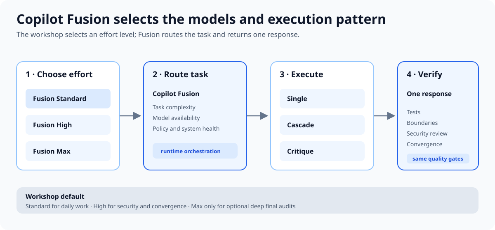

## Workshop default

워크숍의 기본 runtime model은 **GitHub Copilot Fusion**입니다. Copilot
Fusion은 하나의 고정 model이 아니라 task에 맞는 model과 execution pattern을
선택하는 intelligent runtime router and orchestrator입니다.

GitHub는 2026년 10월 28일 Copilot Fusion을 GA로 발표했습니다. 공식 발표에
따르면 Copilot Fusion은 Project HydraFusion의 multi-model orchestration과
Copilot auto model selection을 결합합니다.

Agent와 workflow 파일에는 `model`을 고정하지 않습니다. Workshop participant가
VS Code 또는 Copilot CLI의 runtime model picker에서 Fusion effort level을
선택합니다. 이 방식은 plan, organization policy, client availability를
존중하면서 plugin portability를 유지합니다.

## Select Copilot Fusion

### Visual Studio Code

1. Copilot Chat의 model picker를 엽니다.
2. **Copilot Fusion**을 선택합니다.
3. 현재 task에 맞는 **Standard**, **High**, **Max** effort level을 선택합니다.

### Copilot CLI

Interactive session에서 `/model`을 입력하고 Copilot Fusion effort level을
선택합니다.

Non-interactive command:

```bash
copilot --model fusion --fusion-tier standard -p "YOUR PROMPT"
copilot --model fusion --fusion-tier high -p "YOUR PROMPT"
copilot --model fusion --fusion-tier max -p "YOUR PROMPT"
```

Default model은 `/config model`에서 설정할 수 있습니다. Project settings,
administrator policy, explicit CLI options가 default보다 우선할 수 있습니다.

## Effort-level guide

| Effort | Workshop use | Trade-off |
|---|---|---|
| Fusion Standard | S0–S3, S5의 일상적인 조사, 계획, 구현, packaging | Cost, quality, latency 균형 |
| Fusion High | S4 security review, complex bug, 여러 파일 변경, S6 convergence | 추가 orchestration과 AI credits 가능 |
| Fusion Max | Optional final audit, 가장 깊은 architecture/security reasoning | 가장 높은 capability, cost와 latency 증가 가능 |

Max를 항상 기본값으로 사용하지 않습니다. GitHub는 Fusion 사용 시 내부에서
호출한 각 model의 standard rate를 기준으로 billing하며, High와 Max는 여러
model call을 사용할 수 있습니다.

## Execution patterns



Copilot Fusion은 prompt마다 필요한 pattern을 선택합니다.

* **Single:** 한 model이 task를 직접 처리합니다.
* **Cascade:** efficient model의 draft를 검사하고 필요할 때 stronger model로
  escalate합니다.
* **Critique:** 한 model이 draft하고 다른 model이 review한 뒤 original model이
  revise합니다.

Fusion 내부의 Critique는 workshop의 explicit role separation을 대체하지
않습니다. Security reviewer는 read-only 권한, 정해진 review scope, file/line
evidence를 유지하고 convergence reviewer는 spec-to-code mapping을 수행합니다.

## Role matrix

| Role | Required capability | Output | Required evidence |
|---|---|---|---|
| Researcher | 긴 context, 최신 자료, source tracking | 근거와 미확인 가정 | file path와 official URL |
| Planner | constraints 통합, task decomposition | plan, tasks | requirement traceability |
| Test writer | acceptance criteria의 정밀한 해석 | failing test | 예상 이유의 RED |
| Implementer | repository 이해, type safety | 최소 구현 | targeted와 full GREEN |
| Reviewer | independent reasoning, adversarial review | evidence-based findings | 작성자와 분리된 context |
| Convergence reviewer | 전체 scope 대조 | remaining tasks 또는 clean result | spec-to-code mapping |

## Availability and policy

Copilot Fusion은 모든 Copilot plan에서 제공되지만, 실제 model pool은 다음
조건에 따라 달라집니다.

* User plan에서 사용할 수 있는 model
* Organization 또는 enterprise model policy
* Data residency, FedRAMP, evaluation-model restrictions
* Client version과 실시간 model availability

필요한 model이 policy로 비활성화되면 일부 effort level 또는 Fusion 자체가
model picker에 나타나지 않을 수 있습니다.

## Failure handling

1. Fusion 또는 선택한 effort level이 없으면 model picker와 admin policy를
   확인합니다.
2. 선택 실패를 숨기거나 다른 model로 조용히 대체하지 않습니다.
3. 같은 role contract를 만족하는 지원 model을 명시적으로 선택합니다.
4. Independent review role은 작성자와 다른 context를 유지합니다.
5. Model이 바뀌어도 같은 tests, boundaries, security rules, convergence gate를
   다시 실행합니다.

Model fallback은 quality-gate fallback이 아닙니다.

## Official sources

* [About GitHub Copilot Fusion](https://docs.github.com/en/copilot/concepts/models/copilot-fusion)
* [Choosing a model in GitHub Copilot CLI](https://docs.github.com/en/copilot/how-tos/copilot-cli/use-copilot-cli/choose-a-model)
* [Copilot Fusion GA announcement](https://github.blog/changelog/2026-10-28-route-and-orchestrate-models-with-github-copilot-fusion/)
* [Project HydraFusion research preview](https://github.blog/ai-and-ml/github-copilot/project-hydrafusion-frontier-quality-via-multi-model-orchestration/)
